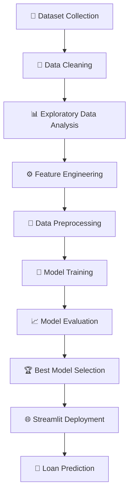

# 🏦 Loan Prediction Using Machine Learning


<h3 align="center">
  An Intelligent Machine Learning System for Loan Prediction
</h3>

<p align="center">
  
</p>

<p align="center">
  
  
  
  
</p>

<p align="center">
  
  
  
</p>


---

## 📌 Project Overview

The **Loan Prediction System** is a Machine Learning project designed to analyze applicant financial information and predict loan outcomes.

The system uses applicant details such as income, credit history, employment status, loan amount, and other financial factors to generate predictions.

By leveraging Machine Learning algorithms, this project demonstrates how predictive analytics can support faster, more consistent, and data-driven financial decision-making.

🎯 **Goal:** Build an intelligent predictive system that simplifies the loan evaluation process.

---

## 🎯 Project Objectives

- Develop a Machine Learning model for loan prediction.
- Analyze applicant financial and personal information.
- Perform data cleaning and preprocessing.
- Identify important features influencing loan outcomes.
- Compare different Machine Learning algorithms.
- Evaluate model performance using suitable metrics.
- Deploy an interactive prediction application using Streamlit.

---

## ✨ Key Features

| Feature                | Description                             |
| ---------------------- | --------------------------------------- |
| 📊 Data Analysis       | Explore applicant financial information |
| 🧹 Data Preprocessing  | Handle missing values and duplicates    |
| 🔄 Feature Engineering | Transform and select relevant features  |
| 🤖 ML Algorithms       | Train and compare multiple models       |
| 📈 Model Evaluation    | Measure prediction performance          |
| 🎯 Prediction          | Generate loan prediction results        |
| 🌐 Web Application     | Interactive Streamlit deployment        |

---

## 🛠️ Technologies & Tools

### Programming Language

\<p>
&#x20; \
\</p>

### Machine Learning

\<p>
&#x20; \
&#x20; \
&#x20; \
&#x20; \
&#x20; \
\</p>

### Data Processing & Visualization

\<p>
&#x20; \
&#x20; \
&#x20; \
\</p>

### Deployment & Development

\<p>
&#x20; \
\</p>

---

## 📂 Dataset Description

The dataset contains applicant-related financial and personal information.

| Feature             | Description                     |
| ------------------- | ------------------------------- |
| Applicant Income    | Income of the primary applicant |
| Co-applicant Income | Income of the co-applicant      |
| Loan Amount         | Requested loan amount           |
| Loan Term           | Loan repayment duration         |
| Credit History      | Applicant's credit history      |
| Gender              | Applicant gender                |
| Marital Status      | Marital information             |
| Education           | Education qualification         |
| Property Area       | Property location category      |

### Data Preprocessing

- Handled approximately 10–20% missing values.
- Encoded categorical variables.
- Normalized numerical features where required.
- Prepared the dataset for model training.
- Performed feature engineering and selection.

---

## 🔬 Machine Learning Workflow



---

## 🤖 Machine Learning Algorithms

The following algorithms are explored for model development and comparison:

| Algorithm              | Application                      |
| ---------------------- | -------------------------------- |
| Logistic Regression    | Loan approval classification     |
| Decision Tree          | Rule-based prediction            |
| Random Forest          | Ensemble-based prediction        |
| Support Vector Machine | Classification                   |
| Linear Regression      | Numerical loan amount estimation |

**Note:** Loan approval prediction is a classification task, while loan amount prediction is a regression task. Their targets and evaluation metrics are different.

---

## 📊 Model Evaluation

The model performance is evaluated using the following metrics.

### Classification Metrics

- Accuracy
- Precision
- Recall
- F1-Score

### Regression Metrics

- Mean Absolute Error (MAE)
- Mean Squared Error (MSE)
- R² Score

### Model Performance

| Metric        | Reported Result      |
| ------------- | -------------------- |
| Accuracy      | Approximately 80–90% |
| Dataset       | 5,000+ records       |
| Best F1-Score | 0.86                 |
| Precision     | 0.88                 |
| Recall        | 0.84                 |

*Performance values depend on the dataset split and prediction target. Regression metrics should be reported separately for loan amount estimation.*

---

## 💡 Key Insights

- Credit history plays an important role in loan approval prediction.
- Higher applicant income can improve loan eligibility.
- Co-applicant income contributes to the financial profile.
- Loan amount and employment-related information can influence lending decisions.
- Data preprocessing and feature engineering help improve model performance.

---

## 🌐 Live Application

\<p align="center">
&#x20; \<a href="[https://loanprediction-ml.streamlit.app/](https://loanprediction-ml.streamlit.app/)">
&#x20;   \
&#x20; \</a>
\</p>

The Streamlit application allows users to:

- Enter applicant information.
- Provide financial details.
- Submit inputs to the trained model.
- View instant prediction results.

🔗 **Live Demo:** [https://loanprediction-ml.streamlit.app/](https://loanprediction-ml.streamlit.app/)

---

## 📁 Project Structure

```text
Loan_Prediction/
│
├── app.py
├── model/
│   └── loan_model.pkl
│
├── dataset/
│   └── loan_data.csv
│
├── notebooks/
│   └── loan_prediction.ipynb
│
├── requirements.txt
├── README.md
└── .gitignore
```

*This is an illustrative structure. Adjust filenames and folders to match your actual repository.*

---

## ⚙️ Installation & Setup

### 1. Clone the Repository

```bash
git clone https://github.com/nameisnarayana7/Loan_Prediction.git
```

### 2. Navigate to Project Folder

```bash
cd Loan_Prediction
```

### 3. Create Virtual Environment

```bash
python -m venv venv
```

### 4. Activate Environment

**Windows:**

```bash
venv\Scripts\activate
```

**Linux / macOS:**

```bash
source venv/bin/activate
```

### 5. Install Dependencies

```bash
pip install -r requirements.txt
```

### 6. Run Application

```bash
streamlit run app.py
```

---

## 📦 Requirements

Example dependencies (adjust according to your actual imports):

```text
numpy
pandas
scikit-learn
matplotlib
seaborn
streamlit
joblib
```

---

## 🚀 Future Enhancements

- Integrate advanced models such as XGBoost.
- Improve model performance using larger datasets.
- Implement advanced feature selection techniques.
- Add explainable AI using SHAP.
- Integrate secure banking APIs.
- Add user authentication.
- Improve UI and interactive visualizations.
- Implement continuous model monitoring.

---

## 🎓 What I Learned

Through this project, I gained practical experience in:

- End-to-end Machine Learning workflows.
- Data cleaning and exploratory data analysis.
- Feature engineering and preprocessing.
- Classification and regression algorithms.
- Model evaluation and performance optimization.
- Deploying Machine Learning applications using Streamlit.

---

## 👨‍💻 Author

\<h3 align="center">Kondeti Lakshmi Narayana Murthi\</h3>

\<p align="center">   Aspiring AI/ML Engineer | Python Developer | Data Science Enthusiast \</p>

\<p align="center">   \<a href="[https://github.com/nameisnarayana7](https://github.com/nameisnarayana7)">     \   \</a>   \<a href="[https://linkedin.com/in/srilakshminarayana](https://linkedin.com/in/srilakshminarayana)">     \   \</a>   \<a href="[https://nameisnarayana7.github.io/portfolio_CV/](https://nameisnarayana7.github.io/portfolio_CV/)">     \   \</a> \</p>

---

\<h3 align="center">
&#x20; 💡 "Turning Financial Data Into Intelligent Decisions."
\</h3>

\<p align="center">
&#x20; ⭐ If you find this project useful, consider giving it a star!
\</p>
